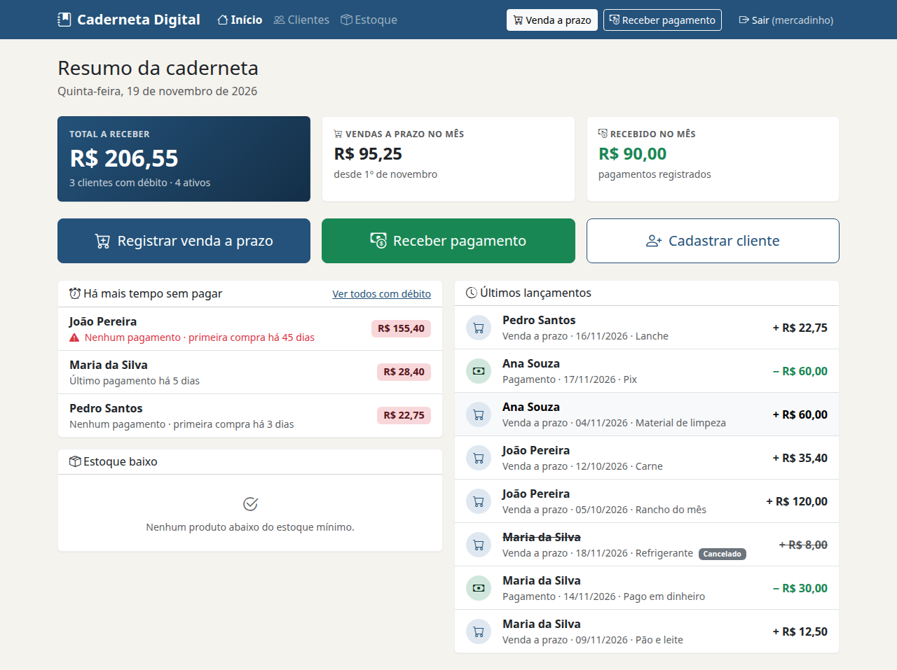
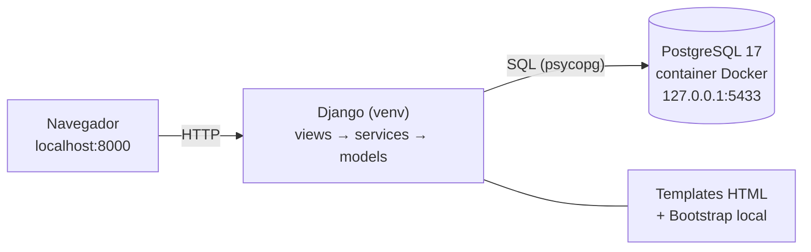
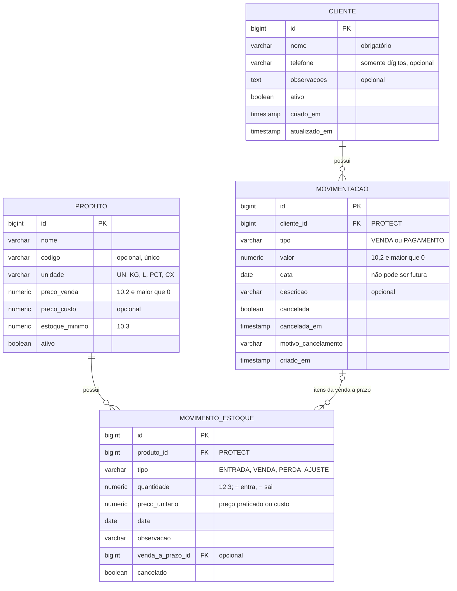

# Caderneta Digital

Aplicação web local para o controle de **vendas a prazo ("fiado")** em pequenos comércios. Ela substitui a
caderneta de papel: o comerciante cadastra clientes, registra vendas e pagamentos, consulta o saldo
devedor e o histórico de cada cliente e vê, na tela inicial, quanto tem a receber. Um **controle de
estoque** opcional registra os produtos da loja e dá baixa automática quando eles são vendidos.

Projeto Integrador II, Análise e Desenvolvimento de Sistemas (UNESC).



## Funcionalidades

- **Clientes:** cadastro com nome, telefone e observações; busca por nome ou telefone; filtros (ativos, com
  débito, em dia, inativos); inativação e reativação.
- **Venda a prazo e pagamento** em duas etapas (escolher o cliente, depois informar o valor), com **prévia do
  novo saldo** antes de confirmar e o botão "quitar todo o saldo".
- **Saldo devedor** sempre calculado a partir das movimentações gravadas: vendas − pagamentos.
- **Histórico** de cada cliente **separado por mês**, com o saldo acumulado após cada lançamento, como na
  caderneta de papel. Cada mês abre e fecha e mostra no título as compras e os pagamentos do mês; o mês
  mais recente já vem aberto.
- **Faturas por mês:** para cada cliente, a fatura de cada mês, com as compras do mês, quanto já foi pago,
  quanto falta e a situação (**Quitada**, **Paga em parte** ou **Em aberto**). Um pagamento feito em
  novembro para a fatura de outubro aparece descontado em outubro. Cada fatura pode ser aberta e
  impressa, com as compras e os pagamentos descontados dela.
- **Pagar por fatura:**
  - na tela de pagamento, o comerciante escolhe qual fatura (mês) o cliente está pagando, e o valor e a
    descrição são preenchidos sozinhos;
  - para pagar **só uma parte**, basta alterar o valor: a tela mostra na hora o que fica quitado e quanto
    vai faltar em cada mês.
- **Cancelamento (estorno)** de lançamentos digitados por engano, com motivo obrigatório. O lançamento
  continua visível no histórico.
- **Painel inicial:** total a receber, vendas e recebimentos do mês, clientes **há mais tempo sem pagar** e
  últimos lançamentos.
- **Extrato imprimível** para mostrar ao cliente.
- **Estoque:**
  - **Produtos:** nome, código (opcional), unidade (un, kg, L, pacote, caixa), preço de venda, custo e
    estoque mínimo.
  - **Movimentos:** entrada (reposição), venda à vista, perda (vencido, quebrado…) e ajuste pela contagem
    física, com histórico e cancelamento.
  - **Venda a prazo com produtos (opcional):** o valor é calculado pelos produtos escolhidos, o estoque
    baixa na hora e, se a venda for cancelada, os produtos voltam ao estoque.
  - **Avisos:** "estoque baixo" no painel e valor total em estoque (a preço de venda e de custo).
- Campos de valor e quantidade **aceitam apenas números** (e uma vírgula).
- **Acesso protegido por senha**, criado no primeiro uso, sem senha padrão no código.
- Funciona **sem internet** depois de instalado, e se adapta à tela do celular.

## Tecnologias

| Camada | Tecnologia |
|---|---|
| Linguagem / framework | Python 3.12 + Django 5.2 |
| Interface | Django Templates (HTML), CSS, Bootstrap 5.3 e Bootstrap Icons (arquivos locais) |
| Banco de dados | PostgreSQL 17 em container Docker |
| Ambiente | venv (ambiente virtual Python), Docker Compose, VS Code |
| Testes | Testes automatizados do Django (`manage.py test`) |

## Como executar

### Pré-requisitos

- Python 3.12 ou superior
- Docker com Docker Compose
- VS Code (recomendado). Ao abrir a pasta, o VS Code sugere as extensões em `.vscode/extensions.json`.

### Iniciar com um clique (recomendado)

| Sistema | Como iniciar |
|---|---|
| **Linux** | Rode `./iniciar.sh`. Para ter um **ícone no menu de aplicativos** (e na Área de Trabalho), rode uma vez `scripts/criar_atalho_linux.sh`; depois é só clicar em "Caderneta Digital". |
| **Windows** | Dê dois cliques em **`iniciar.bat`**. |

O script faz tudo sozinho:

1. **Na primeira vez:** cria o venv, instala as dependências e gera o `.env` com chave secreta e senha do
   banco aleatórias. Isso precisa de internet.
2. Sobe o PostgreSQL no Docker e aplica as tabelas que estiverem faltando.
3. Inicia o sistema e abre o navegador em **http://localhost:8000**.

Se o sistema já estiver aberto, o script só abre o navegador. Para encerrar, basta fechar a janela do
terminal. O Docker precisa estar instalado e em execução.

### Passo a passo manual (primeira vez)

```bash
# 1. Criar e ativar o ambiente virtual (venv)
python3 -m venv .venv
source .venv/bin/activate          # Windows: .venv\Scripts\activate

# 2. Instalar as dependências dentro do venv
pip install -r requirements.txt

# 3. Criar o arquivo de configuração
cp .env.example .env               # Windows: copy .env.example .env
# Edite o .env: troque DJANGO_SECRET_KEY e POSTGRES_PASSWORD.
# Para gerar uma chave:
python -c "from django.core.management.utils import get_random_secret_key as g; print(g())"

# 4. Subir o PostgreSQL (Docker)
docker compose up -d

# 5. Criar as tabelas no banco
python manage.py migrate

# 6. Iniciar a aplicação
python manage.py runserver
```

Acesse **http://localhost:8000**. No primeiro acesso, a aplicação pede para criar o usuário e a senha do
comerciante.

> No VS Code, também é possível iniciar pelo menu **Executar e Depurar → "Django: executar servidor"**.

### Uso no dia a dia

Use o **iniciar com um clique** acima, ou, manualmente:

```bash
docker compose up -d               # o banco reinicia sozinho com o Docker, mas não custa garantir
source .venv/bin/activate
python manage.py runserver
```

**Sem internet:** depois da instalação, nada depende de conexão. O Bootstrap e os ícones ficam em
`static/vendor/`, e o banco roda localmente. A internet só é necessária para instalar ou atualizar as
dependências e a imagem do PostgreSQL.

Para o uso pelo comerciante, defina `DJANGO_DEBUG=False` no `.env`. Assim, detalhes técnicos de erros não
aparecem na tela.

## Testes

```bash
python manage.py test
```

São **139 testes**:

- `caderneta/tests/test_regras.py`: regras de negócio, cálculo do saldo, histórico, resumo, restrições do
  banco e leitura de valores.
- `caderneta/tests/test_telas.py`: fluxos completos pelas telas (login, cadastro, venda, pagamento,
  cancelamento, filtros etc.).
- `estoque/tests/test_regras.py`: cálculo do estoque, unidades inteiras e fracionadas, estoque
  insuficiente, perda, ajuste, cancelamento, estoque baixo e restrições do banco.
- `estoque/tests/test_integracao.py`: venda a prazo com produtos (valor calculado, baixa, devolução no
  cancelamento, nada gravado se faltar estoque).
- `estoque/tests/test_telas.py`: telas do estoque, venda à vista e venda a prazo com produtos.
- `caderneta/tests/test_conta_mensal.py`: faturas por mês (pagamento de um mês descontado da fatura
  anterior, pagamento dividido entre faturas, cancelados), fatura do mês e tela de pagamento por fatura,
  inclusive pagamento parcial.
- `estoque/tests/test_correcoes.py`: correções da revisão de código (quantidade com ponto, histórico
  nunca negativo, limites de valor, custo ao cancelar, unidade bloqueada, preço alterado).

Os testes rodam no próprio PostgreSQL: o Django cria e apaga um banco temporário `test_caderneta`.

## Backup e restauração

Os dados ficam no volume Docker `caderneta-digital_dados_postgres` e continuam lá ao fechar o navegador,
parar a aplicação ou reiniciar o computador.

```bash
scripts/backup.sh                                            # gera backups/caderneta_<data>.sql
scripts/restaurar.sh backups/caderneta_2026-11-19_18-00-00.sql   # substitui os dados atuais
```

- A restauração é segura:
  - antes de substituir os dados, ela **gera um backup dos dados atuais**;
  - roda em **uma única transação**: se algo falhar, o banco fica exatamente como estava;
  - funciona também com backups de versões anteriores do sistema. Nesse caso, depois rode
    `python manage.py migrate`.
- No Windows, execute os scripts pelo **Git Bash**.
- Guarde uma cópia do backup fora do computador. O arquivo contém dados pessoais dos clientes.
- ⚠️ `docker compose down -v` **apaga** o volume e todos os dados. Para parar o banco, use
  `docker compose stop`.

## Estrutura do projeto

```text
caderneta-digital/
├── config/                 Configurações do Django (settings.py, urls.py, wsgi.py)
├── caderneta/              App principal: clientes e lançamentos
│   ├── models.py           Cliente, Movimentacao e o cálculo do saldo (ClienteQuerySet.com_saldo)
│   ├── services.py         Regras de negócio: registrar venda/pagamento, cancelar, histórico, resumo
│   ├── forms.py            Formulários e validações (com classes do Bootstrap)
│   ├── views.py            Telas: painel, clientes, lançamentos, extrato
│   ├── urls.py             Rotas
│   ├── utils.py            Formatação de moeda e telefone, leitura de valores "12,50"
│   ├── admin.py            Administração (lançamentos somente leitura)
│   ├── templatetags/       Filtros de template: moeda, telefone, tempo_desde
│   ├── migrations/         Estrutura das tabelas
│   └── tests/              Testes automatizados
├── estoque/                App de estoque: produtos e movimentos
│   ├── models.py           Produto, MovimentoEstoque e o cálculo do estoque (ProdutoQuerySet.com_estoque)
│   ├── services.py         Regras: entrada, venda, perda, ajuste, cancelamento, baixa da venda a prazo
│   ├── forms.py            Formulários, incluindo a lista de produtos de uma venda (formset)
│   ├── views.py / urls.py  Telas do estoque e venda à vista
│   └── tests/              Testes do estoque e da integração com a caderneta
├── contas/                 Primeiro acesso, login e logout
├── templates/              Páginas HTML (base.html, telas e trechos reutilizáveis)
├── static/
│   ├── css/estilo.css      Tema visual sobre o Bootstrap
│   ├── js/caderneta.js     Prévia do saldo, máscara de telefone, envio único
│   └── vendor/             Bootstrap e Bootstrap Icons (cópia local, para uso offline)
├── scripts/                backup.sh, restaurar.sh, preparar_ambiente.py, criar_atalho_linux.sh
├── iniciar.sh / iniciar.bat  Iniciar com um clique (Linux / Windows)
├── docs/telas/             Capturas de tela da aplicação
├── docker-compose.yml      Serviço PostgreSQL
├── requirements.txt        Dependências Python (instaladas no venv)
└── .env.example            Modelo de configuração
```

### Arquitetura



O código segue o padrão MVT do Django, com uma camada de **serviços** para as regras de negócio:

- **views.py** recebe a requisição, valida o formulário e chama o serviço;
- **services.py** aplica as regras dentro de uma transação e grava no banco;
- **models.py** define as tabelas e o cálculo do saldo, que fica num único lugar.

### Modelo de dados



O **saldo não é armazenado**. Ele é calculado pelo banco a cada consulta:

```text
saldo = Σ valor (VENDA, não cancelada) − Σ valor (PAGAMENTO, não cancelado)
```

Assim, o valor exibido nunca diverge das movimentações gravadas (RNF002). O estoque segue a mesma ideia:

```text
estoque = Σ quantidade (movimentos não cancelados)   — entradas positivas, saídas negativas
```

## Regras de negócio

O documento do PI deixou algumas decisões "a validar com o comerciante". Nesta versão, elas ficaram assim:

| Situação | Decisão |
|---|---|
| Pagamento maior que o saldo | **Recusado**, com a mensagem "O pagamento (R$ X) é maior que o saldo devedor (R$ Y)". A caderneta não guarda crédito a favor do cliente. |
| Dados mínimos do cadastro | **Nome** obrigatório. Telefone (com DDD) e observações são opcionais (LGPD: só o necessário). |
| Lançamento digitado errado | Não é editado nem apagado: é **cancelado com motivo** e continua no histórico. |
| Cancelar uma venda já paga | Recusado se o saldo ficasse negativo. É preciso cancelar o pagamento antes. |
| Data do lançamento | Pode ser retroativa (para passar a caderneta de papel para o sistema), mas nunca futura. |
| De qual fatura o pagamento é descontado | Das **faturas mais antigas primeiro**, não importa em que mês o pagamento foi feito. Por isso, pagar um mês inclui os meses anteriores em aberto, e um pagamento parcial deixa em aberto só o restante daquela fatura. Um pagamento pode ser dividido entre duas faturas. |
| Cliente inativo | Não recebe novas vendas, mas pode pagar o que deve. Histórico e saldo são mantidos. |
| Excluir cliente | Só se não tiver nenhum lançamento. Caso contrário, deve ser inativado. |

Regras do estoque:

| Situação | Decisão |
|---|---|
| Estoque negativo | **Nunca acontece**, nem hoje nem em nenhum ponto do histórico. Venda, perda (inclusive com data retroativa), ajuste ou cancelamento que deixariam o estoque abaixo de zero são recusados com mensagem clara. |
| Preço alterado com a venda aberta | Se o preço de um produto mudar entre abrir a tela e confirmar, a venda é recusada com aviso e o total é recalculado para nova conferência. |
| Trocar a unidade | Só é possível em produto sem movimentos. Com histórico, a unidade fica bloqueada. |
| Limite de valor | Vendas acima de R$ 99.999.999,99 são recusadas com mensagem (inclusive quando o total vem dos produtos). |
| Venda com vários produtos e um sem estoque | A venda inteira é recusada e **nada é gravado**: nem o lançamento na caderneta, nem a baixa dos outros produtos. |
| Unidades | `un`, `pct` e `cx` aceitam só quantidades inteiras; `kg` e `L` aceitam até 3 casas decimais (ex.: 0,350 kg). |
| Preço na venda | O preço do momento da venda fica gravado no movimento. Mudar o preço depois não altera vendas antigas. |
| Venda a prazo com produtos | O valor é o total dos produtos (o valor digitado é ignorado). Sem produtos, a venda funciona como antes. |
| Cancelar venda a prazo com produtos | Os produtos voltam ao estoque automaticamente. Um item dessa venda não pode ser cancelado sozinho no estoque. |
| Produto inativo | Não recebe entradas nem vendas, mas aceita perda e ajuste (para zerar o que sobrou). |
| Custo | Uma entrada com custo informado atualiza o preço de custo do produto. Se essa entrada for cancelada, o custo volta ao da entrada válida anterior. |
| Excluir produto | Só se não tiver movimentos. Caso contrário, deve ser inativado. |

Cada regra fica em uma única função de `caderneta/services.py` ou `estoque/services.py`. Para mudar uma
regra (por exemplo, passar a aceitar crédito), basta alterar essa função.

## Rastreabilidade dos requisitos

| Requisito | Implementação | Testes |
|---|---|---|
| RF001 Cadastrar clientes | `ClienteForm`, `ClienteCreateView`, `ClienteUpdateView` | `ClienteTelasTests` |
| RF002 Registrar venda a prazo | `services.registrar_movimentacao`, `NovoLancamentoView` | `RegistroTests`, `LancamentoTelasTests` |
| RF003 Registrar pagamento | `services.registrar_movimentacao` (tipo PAGAMENTO) | `test_pagamento_maior_que_o_saldo_*` |
| RF004 Consultar saldo pendente | `ClienteQuerySet.com_saldo`, lista e detalhe do cliente | `SaldoTests`, `test_lista_filtra_*` |
| RF005 Histórico de movimentações | `services.historico_do_cliente`, `services.historico_por_mes` (separado por mês), detalhe e extrato | `HistoricoTests`, `HistoricoPorMesTests`, `test_extrato` |
| RF006 Atualizar saldo | Saldo calculado sempre a partir das movimentações | `SaldoTests` |
| RF007 Cadastrar produtos | `ProdutoForm`, `ProdutoCreateView` (com estoque inicial), `ProdutoUpdateView` | `ProdutoTelasTests` |
| RF008 Movimentar estoque | `estoque/services.py`: entrada, venda à vista, perda, ajuste, cancelamento | `estoque/tests/test_regras.py`, `MovimentoTelasTests` |
| RF009 Consultar estoque e alertas | `ProdutoQuerySet.com_estoque`, lista com filtros, histórico do produto, aviso no painel | `ConsultasTests`, `test_painel_mostra_estoque_baixo` |
| RF010 Baixa automática na venda a prazo | `caderneta.services.registrar_movimentacao(itens=...)`, `devolver_itens_da_venda` | `estoque/tests/test_integracao.py` |
| RF011 Faturas por mês do cliente | `services.faturas_do_cliente`, `services.fatura_do_mes`, "Faturas por mês" e fatura com `?mes=AAAA-MM` | `caderneta/tests/test_conta_mensal.py` |
| RF012 Pagar por fatura (inteira ou parcial) | `services.meses_em_aberto`, tela de pagamento com a lista de faturas (`?ate=AAAA-MM` sem JavaScript) | `test_tela_de_pagamento_lista_as_faturas_em_aberto`, `test_pagar_so_uma_parte_da_fatura_passada` |
| RNF Usabilidade | Fluxo em 2 etapas, prévia do saldo, mensagens claras, layout para celular | `test_telas.py` |
| RNF Integridade | `DecimalField`, `CheckConstraint`, `transaction.atomic` + `select_for_update`, lançamentos imutáveis | `IntegridadeNoBancoTests`, `CancelamentoTests` |
| RNF Disponibilidade local | Bootstrap em `static/vendor`, WhiteNoise, PostgreSQL local | Execução com `DJANGO_DEBUG=False` |
| RNF Confiabilidade | Volume Docker persistente, `scripts/backup.sh` | Backup e restauração testados |
| RNF Segurança | Login obrigatório, CSRF, validação de senha, banco publicado só em 127.0.0.1, sessão de 12 h | `AcessoTests` |
| RNF Robustez | Validação em formulário, serviço e banco; mensagens em português; bloqueio de envio duplicado | `RegistroTests`, `test_*_mostra_erro*` |
| RNF Instalabilidade | `docker-compose.yml`, `requirements.txt`, `.env.example`, este README | — |
| RNF Verificabilidade | 139 testes automatizados | `python manage.py test` |
| RNF Desempenho | Saldo calculado em SQL (um único JOIN), paginação, índice por cliente e data | — |
| RNF Modificabilidade | Regras em `services.py`, cálculo do saldo em um único método | — |

## Melhorias em relação à proposta inicial

1. **Cancelamento (estorno)** de lançamentos, com motivo e histórico preservado.
2. **Total geral a receber** e indicadores do mês na tela inicial.
3. **Clientes há mais tempo sem pagar**, para tratar o "esquecimento de cobranças" citado no problema.
4. **Login e LGPD:** acesso protegido, coleta mínima de dados e backups tratados como dados pessoais.
5. **Backup e restauração** por script, com o volume Docker documentado.
6. **Extrato imprimível**, que dá transparência para o consumidor (justificativa do projeto).
7. **Integridade reforçada:** valores em `Decimal`, restrições no banco, transações com bloqueio de registro
   e saldo sempre calculado.
8. **Controle de estoque** integrado à venda a prazo, com venda à vista, perdas, ajustes e alerta de
   estoque baixo.
9. **Faturas por mês** de cada cliente, com a fatura do mês para imprimir ou mostrar ao cliente.
10. **Pagamento por fatura**, inteiro ou parcial, com a situação de cada fatura (quitada, paga em parte ou
    em aberto).

> **Atenção ao documento do PI:** a seção 2.2 apresenta "não ter controle de estoque" como diferencial de
> simplicidade. Com o estoque, o diferencial passa a ser outro: o estoque é **opcional**, e o comerciante
> que só quer a caderneta continua lançando vendas apenas pelo valor. As seções 2.2, 4, 7 (requisitos
> RF007–RF012) e 8 (backlog e Kanban) precisam ser atualizadas.
